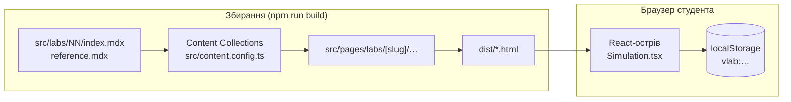

# Архітектура

## Загальна схема



- **Статична генерація.** Усі сторінки — готовий HTML, згенерований під час `npm run build`.
  Сервер не потрібен; Vercel лише роздає файли з `dist/`.
- **Острови.** Інтерактивний лише стенд (`<Simulation client:visible />` у MDX). Він
  рендериться на сервері (для швидкого першого показу), а в браузері «оживає», коли прокрутка
  доходить до нього. Решта сторінки — чистий HTML без JavaScript.

## Лабораторна робота = тека

```
src/labs/03-band-gap/
├─ index.mdx          текст роботи + <Simulation client:visible />  → /labs/band-gap/
├─ reference.mdx      довідник до роботи                           → /labs/band-gap/dovidnyk/
├─ model.ts           фізика (чисті функції, SI)
├─ model.test.ts      тести моделі (зокрема «зворотний»)
├─ Simulation.tsx     віртуальний стенд (React)
├─ Simulation.test.ts SSR-тест стенда
├─ parts/             (необов'язково) частини стенда, якщо Simulation.tsx великий
└─ README.md          опис моделі, зразки, еталонні відповіді, ідеї для варіантів
```

`src/content.config.ts` підхоплює `src/labs/[0-9]*/index.mdx` (колекція `labs`) і
`reference.mdx` (колекція `references`). Теки, що починаються не з цифри (`_template`),
ігноруються. Адреса сторінки = поле `slug` у frontmatter.

Маршрути:

| Файл | Адреса |
|---|---|
| `src/pages/index.astro` | `/` — картки всіх лаб (з колекції, сортування за `number`) |
| `src/pages/labs/[slug]/index.astro` | `/labs/<slug>/` — сторінка роботи (`LabLayout`) |
| `src/pages/labs/[slug]/dovidnyk.astro` | `/labs/<slug>/dovidnyk/` — довідник (`ReferenceLayout`) |
| `src/pages/dovidnyk.astro` | `/dovidnyk/` — загальний довідник (`src/reference/general.mdx`) |

`LabLayout` сам виводить шапку-«штамп», «Мету роботи», «Обладнання» (з frontmatter), бічний
зміст (з заголовків `##`), картку довідника і навігацію між роботами.

## Потік даних у стенді

```
параметри (стан React: напруга, температура, перемикачі…)
      │
      ▼
model.simulate(params, sample)          ← src/labs/NN/model.ts   (істинні значення, SI)
      │
      ▼
readInstrument(spec, range, value, rng) ← src/core/instruments.ts
      │   шум (σ ≈ 0,3·Δ приладу) → квантування (½ поділки / 1 розряд) → перевірка межі
      ▼
Reading { value, raw, overRange, … }     → AnalogMeter / DigitalMeter
      │
      ▼ «Записати вимір»
readingIn(reading, factor) → рядок таблиці (у одиницях стовпця) → useMeasurements → localStorage
      │
      ▼
Plot (точки з таблиці) + linearFit / fitThroughOrigin (МНК)
```

### Детермінований шум

`useNoise(labId).rngFor(ключ_параметрів, тег_приладу)` повертає PRNG, засіяний
`('noise', labId, номер_виміру, …)`. Наслідки:

- покази не «стрибають» при перемальовуванні, поки параметри ті самі;
- після «Записати вимір» номер виміру зростає → повторний вимір трохи інший (розкид для серії ×3);
- сервер і браузер рендерять однаковий перший показ (немає помилок гідратації).

**Правило:** жодних `Math.random()` чи `Date.now()` під час рендеру. Анімації в реальному часі
(напр. нагрівання печі) — лише в `useEffect` після монтування.

### Прилади

`src/core/instruments.ts` — модель приладу: межі (`RangeSpec`: max, unit, factor, divisions,
internalR_Ohm), клас точності (стрілковий) або `±(a % + n од.)` (цифровий).
`src/core/instrumentCatalog.ts` — конкретні прилади, спільні для всіх лаб і для таблиць Довідника.

### Перевантаження

`src/core/limits.ts`: `'ok' → 'overload' → 'destroyed'` (при перевищенні в 1,5 раза).
«Згорілий» елемент розриває коло до натискання «Замінити елемент» (`DeviceStatus`).

## Стилі

- `src/styles/tokens.css` — усі кольори, шрифти, розміри (CSS-змінні). Змінювати вигляд — тут.
- `src/styles/global.css` — типографіка, «проза», кнопки, таблиці.
- `src/styles/sim.css` — UI-кіт стендів (класи `sim-*`) і схем (`sch-*`).
- Компоненти `.astro` мають власні scoped-стилі.

Концепція дизайну: «лабораторний журнал + інженерне креслення» — паперове тло з сіткою,
креслярський синій, сигнальний помаранчевий, прилади з «бакелітовим» корпусом, графіки на
міліметрівці, шапка роботи у вигляді основного напису креслення.

## Тести

- `src/core/core.test.ts`, `src/physics/physics.test.ts` — ядро й матеріали.
- `src/labs/*/model.test.ts` — фізика кожної лаби, у т.ч. **зворотний тест**: покази приладів →
  обробка за процедурою студента → прихований параметр зразка «X» у межах допуску.
- `src/labs/*/Simulation.test.ts` — стенд рендериться на сервері без помилок.

## Розгортання

Vercel: Framework Preset **Astro**, `npm run build` → `dist/`. Див. README → «Деплой на Vercel».
